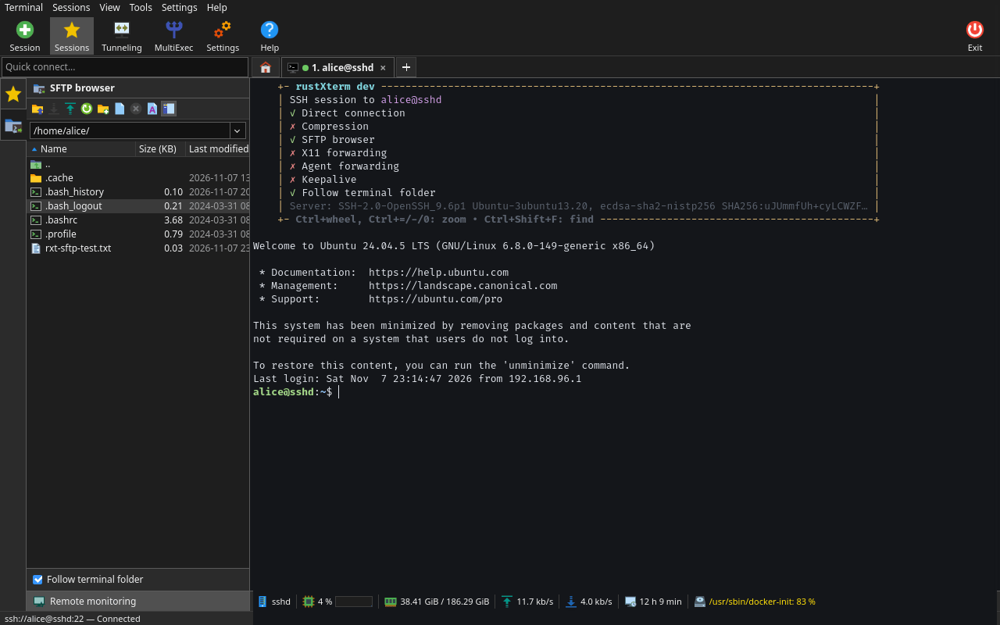
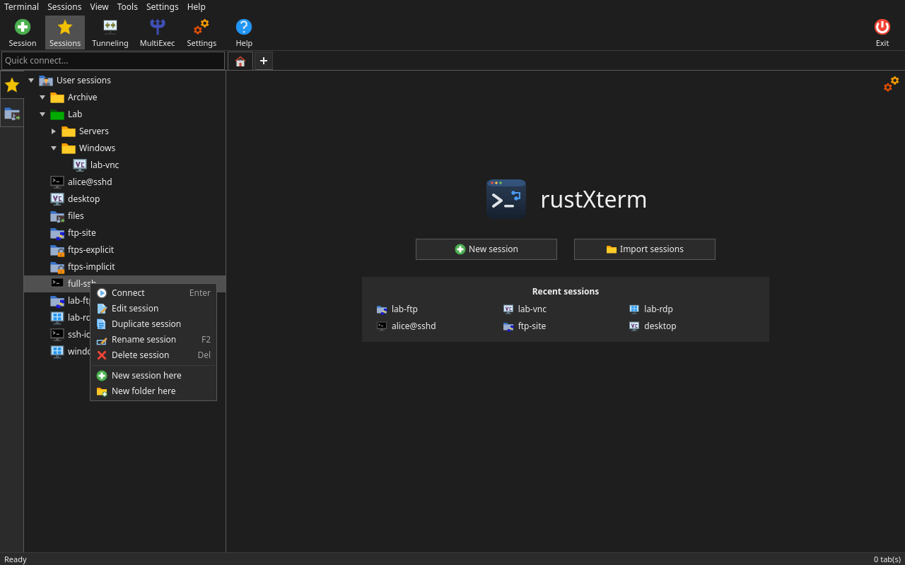
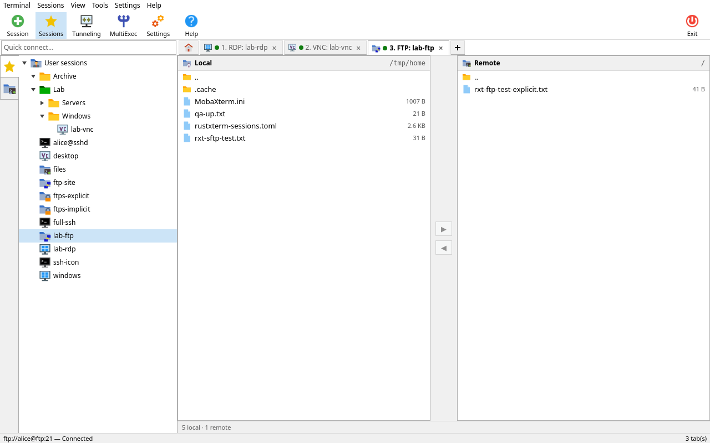
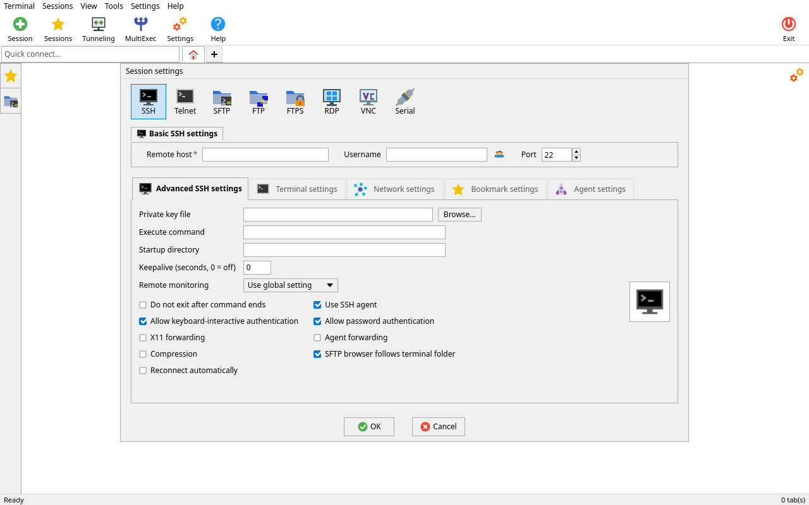
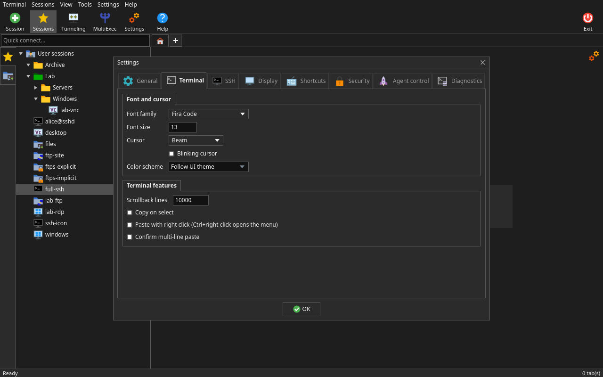
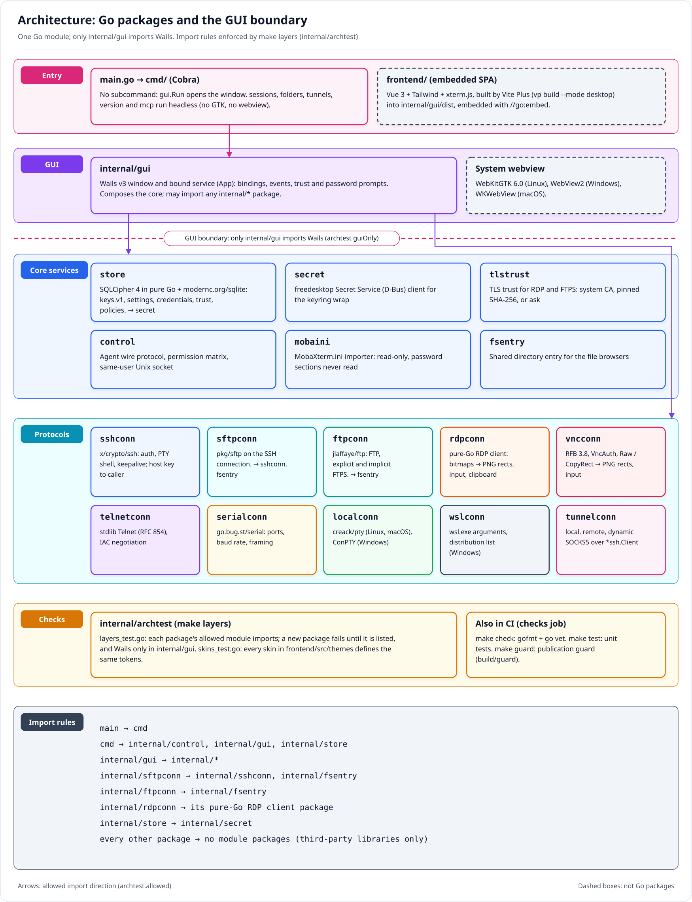

<div align="center">


# rustXterm

**Every remote session you use, in one window.**

SSH, SFTP, FTP/FTPS, RDP, VNC, Telnet, Serial, WSL and local shells in tabs, with a file panel that follows
your shell, live server monitoring and an encrypted session store. One binary for Linux, Windows and macOS
is the desktop app, the CLI and the MCP server.

[](https://github.com/jniltinho/rustXterm/releases)
[](https://github.com/jniltinho/rustXterm/releases)
[](https://github.com/jniltinho/rustXterm/actions/workflows/ci.yml)
[](LICENSE)


**[⬇ Download the latest release](https://github.com/jniltinho/rustXterm/releases/latest)**

[Install](#install) · [Quick start](#quick-start) · [Features](#features) · [CLI and MCP](#cli-and-mcp) · [Build](#build-from-source) · [Docs](#documentation)

<br>

<a href="docs/screenshots/ssh_sftp_monitor_dark.png"></a>

<sub>An SSH tab with the SFTP browser that follows the shell, and the monitoring bar: CPU, memory, network, uptime and disks of the remote host.</sub>

</div>

## Why rustXterm

- **One app instead of five.** Terminals, file transfers and remote desktops live side by side in tabs,
  organized in a session tree with colored folders.
- **Files without leaving the shell.** The SFTP browser opens next to every SSH tab, on the same
  connection, and follows the directory you `cd` into.
- **See your server at a glance.** CPU, memory, disks, network and uptime under each SSH tab, read over
  the existing connection: nothing to install on the server.
- **Secure by default.** Sessions and passwords are encrypted at rest under a master password, optionally
  unlocked by the system keyring; unknown host keys and certificates are shown to you before you log in;
  tunnels bind to loopback unless you confirm otherwise.
- **Bring your sessions.** Import a MobaXterm.ini file (password sections are never read) or a rustXterm
  TOML export.
- **One codebase, three platforms.** Go + [Wails v3](https://v3.wails.io/) on the system webview
  (WebKitGTK, WebView2, WKWebView); every protocol is implemented in Go, with no external clients to
  install.

## Features

| Area | What you get |
|---|---|
| **SSH** | Password, public key (with passphrase prompt), ssh-agent and keyboard-interactive auth; host keys checked against `~/.ssh/known_hosts` and the app's trust records, with an accept once / accept and save / reject dialog; password prompt with **Save password** (stored only after the login succeeds); jump hosts (each hop with its own host-key check and login); agent forwarding; X11 forwarding (real cookie from Xauthority, never sent to the server); environment variables, remote command and startup folder; keepalive; session banner with the server id and host key |
| **Terminal** | xterm.js with truecolor, search (Ctrl+Shift+F), font zoom (Ctrl+wheel, Ctrl+= / Ctrl+- / Ctrl+0), copy on select and right-click paste; 13 color schemes (Solarized, Dracula, Gruvbox, Nord, One Dark, Monokai, Tango, xterm, rustXterm light/dark), global or per session; bundled monospace fonts (Cascadia Mono, JetBrains Mono, Fira Code, Hack, IBM Plex Mono and more) plus your installed ones |
| **Files** | SFTP browser on the SSH tab's own connection with Name, Size, Last modified, Owner, Group and Access columns, sorting, upload, download, new folder, rename, delete and **Follow terminal folder**; dual-pane SFTP and FTP/FTPS tabs (plain FTP, explicit and implicit TLS) |
| **Monitoring** | Agentless bar under SSH tabs with host, CPU (sparkline and warning thresholds), memory, network up/down, uptime and per-disk usage, refreshed every 1 to 30 s on an extra channel of the same connection |
| **Remote desktop** | Pure-Go RDP client (NLA, TLS, certificate trust, clipboard) and VNC client (VncAuth, view-only mode, VNC through an SSH gateway, clipboard, paused while the tab is hidden, hostile sizes refused), drawn on a canvas in the tab |
| **Telnet, Serial, local, WSL** | Telnet sessions; serial consoles (port list, baud rate and framing); the **+** after the last tab (Ctrl+Shift+T) opens your login shell in your home folder (PTY on Linux and macOS, ConPTY on Windows); WSL sessions on Windows |
| **Tunnels** | Local, remote and dynamic (SOCKS5) SSH forwarding in a Tunnels window with per-row start/stop and start all / stop all; listeners bind loopback unless you confirm another address |
| **MultiExec** | Toolbar toggle and a checkbox per terminal tab: input typed in a selected tab goes to every selected tab |
| **Encrypted store** | Sessions, folders, credentials, trust records and agent policies in an SQLCipher 4 database whose key is wrapped by your master password (Argon2id + XChaCha20-Poly1305) and optionally by the system keyring (Secret Service, macOS Keychain, Windows Credential Manager); same formats as the archived Rust app, so existing data opens unchanged |
| **Import and export** | Import sessions from MobaXterm.ini (SSH, SFTP, FTP/FTPS, RDP, VNC, Telnet, Serial, WSL, with folders) after a preview; TOML export and import without passwords |
| **Skins** | Light, Dark, Windows XP, macOS, macOS Dark and Mac OS Retro, plus System (follows the OS light/dark setting live) |
| **Agent control** | `rustxterm-go` CLI and stdio MCP server (store reads today), a same-user control socket on Linux that stays off until you enable it, and a per-session Deny / Ask / Allow agent policy |

Status: Linux x86_64 is the primary target; every screen and protocol is tested there against the Docker
lab. Windows x86_64 and macOS (universal) builds ship with every release and were verified interactively
(see the [parity record](docs/gates/go-parity.md)). Releases are unsigned.

## Screenshots

<table>
  <tr>
    <th>Session tree and home tab (dark)</th>
    <th>Dual-pane FTP tab (light)</th>
  </tr>
  <tr>
    <td><a href="docs/screenshots/session_tree_menu_dark.png"></a></td>
    <td><a href="docs/screenshots/ftp_light.png"></a></td>
  </tr>
  <tr>
    <th>Session editor (light)</th>
    <th>Settings › Terminal (dark)</th>
  </tr>
  <tr>
    <td><a href="docs/screenshots/session_editor_ssh_light.png"></a></td>
    <td><a href="docs/screenshots/settings_terminal_dark.png"></a></td>
  </tr>
</table>

Captured on Linux by `make prints` against the Docker lab with fictional sessions. More screens are in
the [screenshot gallery](docs/screenshots/README.md).

## Install

Download from [GitHub Releases](https://github.com/jniltinho/rustXterm/releases). Every release has:

| Asset | Platform |
|---|---|
| `rustxterm-go-X.Y.Z-linux-amd64` | Linux x86_64 binary (needs GTK 4 and WebKitGTK 6.0: Ubuntu 24.04+, Fedora 39+, Debian 13+) |
| `rustxterm-go-X.Y.Z-x86_64.AppImage` | The same Linux app as an AppImage (uses the system GTK 4 / WebKitGTK 6.0) |
| `rustxterm-go-X.Y.Z-windows-amd64.exe` | Windows x86_64 (WebView2) |
| `rustxterm-go-X.Y.Z_macos_universal.zip` | macOS app bundle `rustXterm (Go).app`, Apple Silicon and Intel |
| `rustxterm-go-X.Y.Z-darwin-amd64`, `rustxterm-go-X.Y.Z-darwin-arm64` | macOS per-architecture binaries |
| `SHA256SUMS` | Checksums for all of the above |

**Linux**

```sh
sha256sum --check --ignore-missing SHA256SUMS
sudo apt install libgtk-4-1 libwebkitgtk-6.0-4     # Debian/Ubuntu, if not installed yet
chmod +x rustxterm-go-X.Y.Z-x86_64.AppImage
./rustxterm-go-X.Y.Z-x86_64.AppImage
```

If the window stays blank or flickers with your GPU driver, start with `--safe-gpu` (or set
`RXT_SAFE_GPU=1`) to turn off webview GPU acceleration.

**Windows:** run `rustxterm-go-X.Y.Z-windows-amd64.exe`. It needs the Microsoft Edge WebView2 runtime,
which Windows 10 and 11 include. The build is unsigned, so SmartScreen may ask for confirmation.

**macOS:** unzip `rustxterm-go-X.Y.Z_macos_universal.zip`, move `rustXterm (Go).app` to Applications and
clear the quarantine flag of the unsigned app once:

```sh
xattr -dr com.apple.quarantine "rustXterm (Go).app"
```

macOS 15 denies Local Network access to unsigned apps, so hosts on the Mac's own subnet are unreachable
from this build; routed hosts work. The Keychain holds the optional store key.

## Quick start

1. Start rustXterm and choose a master password. It encrypts all sessions and credentials and
   **cannot be recovered**. Tick **Unlock with system keyring** to skip the prompt on later starts.
2. Create a session with **New session**, or type `user@host` in **Quick connect**. The **+** after
   the last tab opens a local terminal on your own computer.
3. Check the host key fingerprint and accept it. The SFTP browser opens next to the terminal.
4. To bring sessions from MobaXterm, use **Import sessions** on the home tab and pick your
   `MobaXterm.ini`.

Settings live in `config.toml` in the config folder and data (`rustxterm.db`, `keys.v1`) in the data
folder: `~/.config/rustxterm/` and `~/.local/share/rustxterm/` on Linux (XDG variables honored),
`~/Library/Application Support/rustxterm/` on macOS, `%APPDATA%\rustxterm\` on Windows. These are the
same files the Rust app used.

## CLI and MCP

The same binary is a CLI: with no subcommand it opens the window; with one it runs headless (no GTK, no
webview). It has the same commands, output and exit codes as the Rust `rustxterm` CLI. `--json` prints
compact JSON; errors then print as `{"error":{"code":"…","message":"…"}}` on stdout.

| Command | What it does |
|---|---|
| `sessions list` / `sessions show <id\|name>` | Saved sessions (offline; credentials only as `saved`/`absent`) |
| `sessions add <url> [--name] [--folder a/b]` | Add a session from `ssh://user@host:22`, `rdp://…`, `serial:///dev/ttyUSB0?baud=9600`, `wsl://…` |
| `sessions edit <session> [--name] [--host] [--port] [--user] [--folder]` | Edit non-secret fields |
| `sessions remove <session>` | Remove a session |
| `folders list`, `tunnels list` | Folders and saved tunnels (offline) |
| `export [--out FILE]` | Sessions, folders and tunnels as TOML, no credentials (`--json`: the export document) |
| `import mobaxterm-ini <file>` | Preview MobaXterm bookmarks, confirm, import |
| `open <session>`, `tabs list`, `close <tab>` | Open a saved session, list or close tabs in the running app |
| `send <tab> <text> [--enter]`, `read <tab> [--lines N]` | Type into a tab, read its terminal text |
| `wait <tab> <pattern> [--timeout 10s]` | Wait until a tab's output matches |
| `screenshot <tab> [--out FILE]` | Capture a tab as PNG |
| `files ls <tab> [path]`, `files get <tab> <remote> <local>`, `files put <tab> <local> <remote>` | Files on a tab (local paths inside the agent workspace) |
| `tunnel start <name>`, `tunnel stop <name>` | Start or stop a saved tunnel |
| `serial ports`, `serial break <tab> [--ms N]`, `serial lines <tab> [--dtr on\|off] [--rts on\|off]` | Serial ports and line control |
| `mcp`, `version` | Stdio MCP server; print the version |

Offline reads unlock through the keyring, else the master password typed on a terminal (or
`RXT_MASTER_PASSWORD`). Store changes (`sessions add/edit/remove`, `import`) need the master password
typed on an interactive terminal (never the keyring, a pipe or the environment) and are audited. The
other commands talk to the running app over the agent-control socket and never start the GUI.

MCP clients start `rustxterm-go mcp` over stdio:

```json
{ "mcpServers": { "rustxterm": { "command": "rustxterm-go", "args": ["mcp"] } } }
```

The MCP server defines 20 tools and none that add, edit, remove or import sessions. The read-only tools
(`list_sessions`, `show_session`, `list_folders`, `list_tunnels`) work without a running app; the live
tools (`open_session`, `read_terminal`, `send_input`, `wait_for_output`, `screenshot_tab`, `file_get`,
`file_put`, `tunnel_start`, ...) are listed only while the app's control socket is reachable, and the app
executes them under each session's agent policy.

**Settings › Agent control** turns the control socket on. It speaks the Rust app's wire protocol and accepts
only the same user:
- Linux: a Unix socket in `$XDG_RUNTIME_DIR/rustxterm/`, peer UID checked (SO_PEERCRED);
- macOS: a Unix socket in `$TMPDIR/rustxterm-<uid>/`, peer UID checked (LOCAL_PEERCRED);
- Windows: the named pipe `\\.\pipe\rustxterm-<SID>-control`, with a DACL for the user's SID only, remote clients
  rejected, and each connection's user, integrity and AppContainer state checked.

New sessions default to the `deny` agent policy; the session editor's **Agent** tab sets Deny, Ask or
Allow per session. With Ask, an operation that writes (sending input, files, tunnels, serial lines) waits for
an approval prompt in the app.

<details>
<summary>Exit codes</summary>

| Code | Meaning |
|---|---|
| 0 | Success |
| 1 | Failed |
| 2 | Usage error |
| 3 | Store locked |
| 4 | Denied by policy or approval |
| 5 | rustXterm is not running |
| 6 | Agent control is off |

With `--json`, errors are printed as `{"error":{"code":N,"message":"..."}}`.

</details>

## Architecture

<p align="center">
  
</p>

GUI-free core packages under `internal/` (one per protocol, plus the store, keyring, TLS trust, control
channel and importers); only `internal/gui` imports Wails and binds the core to the Vue SPA. `make layers`
(`internal/archtest`) enforces the import rules and that every skin defines the same tokens. The other
diagrams (data flow, SSH sequence, encrypted store, agent control, build and release, test lab, roadmap,
RDP sequence) are in the [documentation index](docs/README.md).

## Build from source

Builds, lints and tests run only in Docker; the host needs Docker, git and `make`. Every Go target runs
in the `rustxterm-go-linux` image built from `build/linux.Dockerfile` (Go, GTK 4 and WebKitGTK 6.0
headers, AppImage tools); the frontend builds in `node:24`.

```sh
make check test layers   # gofmt + go vet, unit tests, layering and skin-token parity
make guard               # publication guard, run before every push
lab/lab.sh up && make lab-test && lab/lab.sh down   # integration tests against the Docker lab
make build               # Linux binary → dist/
make dist-all            # Linux binary + AppImage, Windows .exe, macOS binaries and universal .app zip
```

The [developer guide](docs/DEVELOPMENT.md) covers the layout, every `make` target and the workflow.

## Documentation

| Document | Contents |
|---|---|
| [Developer guide](docs/DEVELOPMENT.md) | Prerequisites, layout, `make` targets, lab, screenshots, coding rules |
| [Documentation index](docs/README.md) | Architecture, data flow, store, agent control, diagrams, roadmap |
| [RDP guide](docs/rdp.md) | RDP security layers, trust prompts and errors |
| [Screenshot gallery](docs/screenshots/README.md) | Screens in the Light and Dark skins |
| [Releases](docs/release.md) | Cutting and verifying a release |
| [Go parity record](docs/gates/go-parity.md) | Screens, protocols, platforms and benchmark against the Rust app |
| [Protocol lab](lab/README.md) | Docker lab services and fictional credentials |

## History

rustXterm started as a native Rust/egui application (releases up to v0.8.0). It was rewritten in Go +
Wails v3 to reach parity on Linux, Windows and macOS with one codebase, and the Go app continues the
version numbering from v0.9.0. The Rust app is archived, read-only, in
[`archive/rust/`](archive/rust/README.md); the Go app keeps its store, settings, known hosts and keyring
formats.

## Security

- All stored data is encrypted at rest (SQLCipher 4: AES-256-CBC with HMAC-SHA512 per page); the database
  key is wrapped with Argon2id and XChaCha20-Poly1305 by your master password and, optionally, by a random
  key held in the system keyring.
- SSH host keys are checked before authentication, and unknown keys are shown to you first. RDP and FTPS
  certificates the system does not trust are pinned by SHA-256 fingerprint once you accept them.
- Agent control is off by default, reachable only by your user, and never discloses passwords or keys:
  credentials appear only as `saved` or `absent`.
- Releases are built in Docker by `release-go.yml`, only for commits whose CI run is green, and published
  with `SHA256SUMS`.

## Contributing and feedback

Bug reports, ideas and pull requests are welcome: open an
[issue](https://github.com/jniltinho/rustXterm/issues). The [developer guide](docs/DEVELOPMENT.md)
explains the Docker-only workflow and the test lab. If rustXterm is useful to you, a ⭐ helps other
people find it.

## License

rustXterm is released under the [MIT License](LICENSE).

Every icon, image, font and fixture is listed with its origin and license in
[ATTRIBUTION.md](ATTRIBUTION.md). The application icon set in `assets/icons/app/` is original and MIT
licensed; the distribution logos in `assets/icons/app/brands/` are trademarks of their owners.

<details>
<summary>Acknowledgements</summary>

rustXterm stands on great open-source work, including [Wails](https://github.com/wailsapp/wails),
[Vue](https://vuejs.org/), [Tailwind CSS](https://tailwindcss.com/), [Vite+](https://viteplus.dev/),
[xterm.js](https://xtermjs.org/), the Go [x/crypto](https://pkg.go.dev/golang.org/x/crypto) SSH packages,
[pkg/sftp](https://github.com/pkg/sftp), [jlaffaye/ftp](https://github.com/jlaffaye/ftp),
[go.bug.st/serial](https://github.com/bugst/go-serial), [creack/pty](https://github.com/creack/pty),
[modernc.org/sqlite](https://gitlab.com/cznic/sqlite), [godbus](https://github.com/godbus/dbus),
[wincred](https://github.com/danieljoos/wincred), [Cobra](https://github.com/spf13/cobra),
[simple-icons](https://simpleicons.org/) for distribution logos, Tux by Larry Ewing, and the
[Noto Sans](https://notofonts.github.io/), [Cascadia Mono](https://github.com/microsoft/cascadia-code),
[JetBrains Mono](https://www.jetbrains.com/lp/mono/), [Fira Code](https://github.com/tonsky/FiraCode),
[Hack](https://sourcefoundry.org/hack/), [IBM Plex Mono](https://github.com/IBM/plex) and the other bundled
fonts listed in [ATTRIBUTION.md](ATTRIBUTION.md).

</details>
