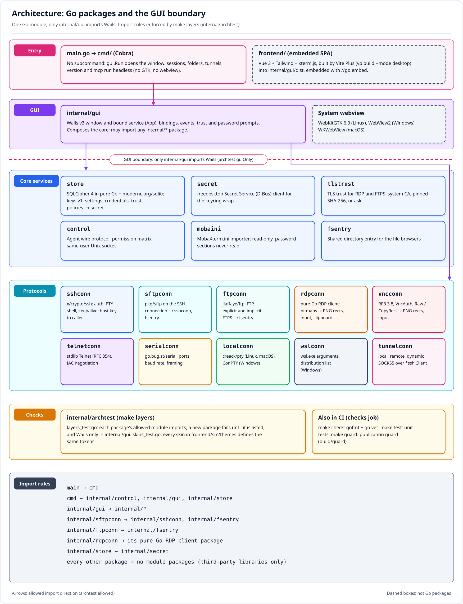
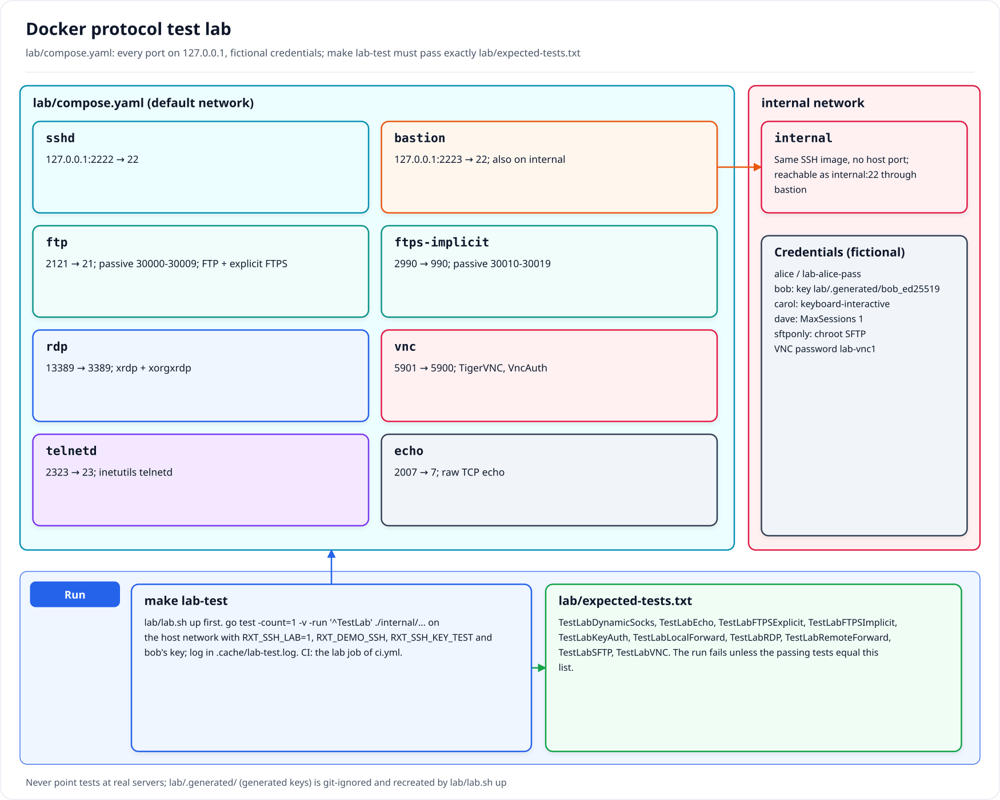
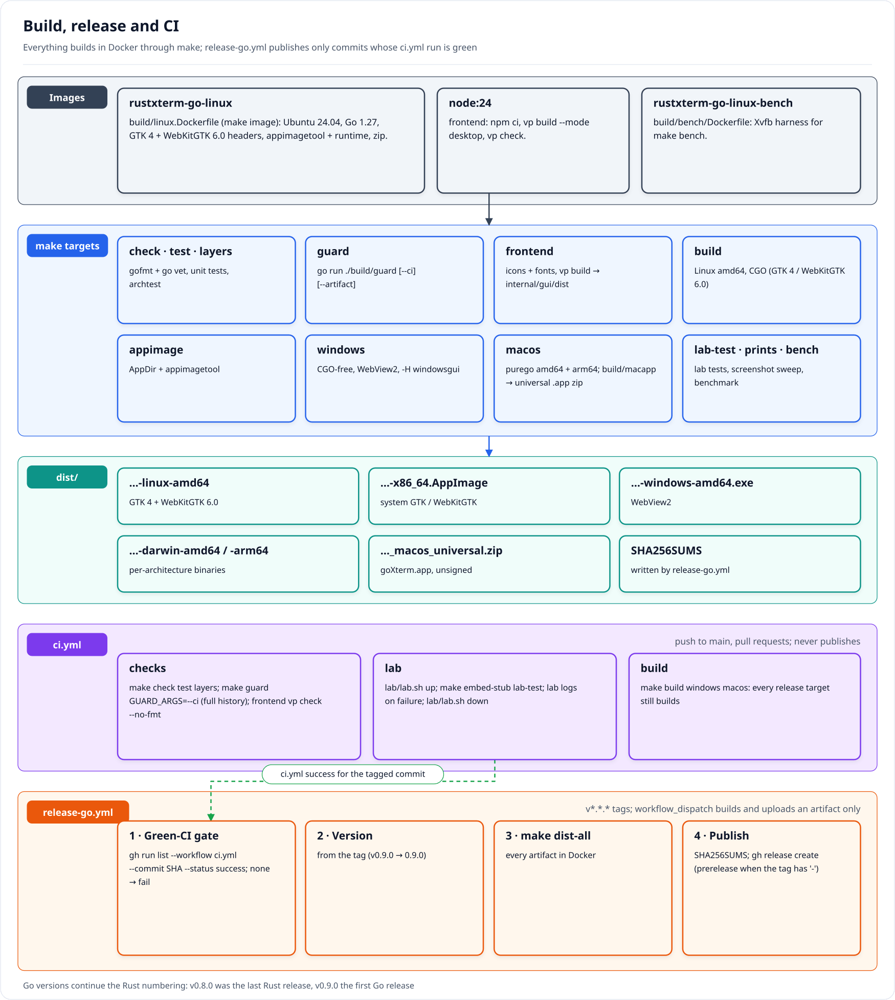

# Developer guide

How to build, test and contribute to rustXterm. Project rules live in [`AGENTS.md`](../AGENTS.md); the
[documentation index](README.md) explains the design.

- [Prerequisites](#prerequisites)
- [Repository layout](#repository-layout)
- [Make targets](#make-targets)
- [Frontend](#frontend)
- [Protocol lab](#protocol-lab)
- [Screenshots, prints and benchmark](#screenshots-prints-and-benchmark)
- [Running the app locally](#running-the-app-locally)
- [CI and release process](#ci-and-release-process)
- [OpenSpec workflow](#openspec-workflow)
- [Coding rules](#coding-rules)
- [Parallel agents](#parallel-agents)
- [Troubleshooting](#troubleshooting)

## Prerequisites

- Docker (with Compose), git and `make`.
- Nothing else. Do **not** install Go, Node, GTK or WebKitGTK on the host: every Go command runs in the
  `rustxterm-go-linux` image (built from `build/linux.Dockerfile` by `make image`: Ubuntu 24.04, Go, GTK 4
  and WebKitGTK 6.0 headers, appimagetool), and the frontend builds in `node:24`. The containers run as
  your UID with the repository mounted at `/src`; Go's build and module caches live in `.cache/`.

After cloning, enable the pre-push publication guard once:

```sh
git config core.hooksPath .githooks
```

## Repository layout

```
main.go             entry point: hands over to cmd/
cmd/                Cobra command line: no subcommand opens the window; sessions, folders, tunnels, version, mcp
internal/gui/       the only package that imports Wails: window, bound service, events, embedded SPA (dist/)
internal/*conn/     one package per protocol (ssh, sftp, ftp, rdp, vnc, telnet, serial, local, wsl, tunnel)
internal/store/     SQLCipher store, keys.v1 envelope, settings, credentials, trust, policies
internal/…          secret (Secret Service), tlstrust, control (agent socket), mobaini, fsentry, archtest
frontend/           Vue 3 + Tailwind SPA (Vite Plus, xterm.js); skins in src/themes/
build/              linux.Dockerfile, linux/ (AppImage files), macapp/, guard/, qa/ (prints), bench/
assets/             icons and fonts (every file listed in ATTRIBUTION.md)
lab/                Docker protocol lab, expected lab tests, keyring and agent checks, optional Vagrant VMs
openspec/           proposals, designs, specs and task lists
docs/               documentation, diagrams, screenshots, gate receipts
archive/rust/       the archived Rust/egui app (read-only, not built or tested)
```

Package import rules are in the [documentation index](README.md#architecture) and enforced by
`make layers`.



## Make targets

Every target runs in Docker. `VERSION` defaults to the exact `v*` tag of `HEAD` without the `v`, else
`dev`; artifacts go to `dist/`.

| Make | Does |
|---|---|
| `make image` | Build the `rustxterm-go-linux` toolchain image |
| `make tidy` | `go mod tidy` |
| `make check` | `gofmt -l` (fails on unformatted files) and `go vet ./...` |
| `make test` | `go test ./...` (unit tests; lab tests skip without the lab) |
| `make layers` | `go test ./internal/archtest`: import rules and skin token parity |
| `make embed-stub` | Placeholder `internal/gui/dist/index.html` so compile-only targets work on a fresh checkout |
| `make frontend` | Copy icons and fonts into `frontend/public/`, then `npm ci` and `vp build --mode desktop` into `internal/gui/dist` |
| `make build` | Frontend + `dist/rustxterm-go-VERSION-linux-amd64` (CGO, GTK 4 / WebKitGTK 6.0) |
| `make appimage` | `dist/rustxterm-go-VERSION-x86_64.AppImage` (system GTK / WebKitGTK) |
| `make windows` | `dist/rustxterm-go-VERSION-windows-amd64.exe` (WebView2, CGO-free) |
| `make macos` | `dist/rustxterm-go-VERSION-darwin-{amd64,arm64}` and `dist/rustxterm-go-VERSION_macos_universal.zip` (purego, CGO-free; `build/macapp` builds the universal `rustXterm (Go).app`) |
| `make dist-all` | `appimage`, `windows` and `macos` |
| `make guard` | Publication guard (`go run ./build/guard`); `GUARD_ARGS=--ci` as CI runs it, `--artifact PATH` to scan a release file |
| `make lab-test` | Go `TestLab*` tests against the running lab (host network) |
| `make prints` | Screenshot sweep of every screen in Light and Dark into `docs/prints/go-linux/` |
| `make bench` | Cold start, terminal throughput and input latency against a Rust release binary |
| `make clean` | Delete `dist/` and `.cache/` without asking |

The guard checks that no commit touches `base/` or `docs/prints/`, that no file in the tree, the history
or a release artifact is a copy of a file under `base/` or holds a real absolute home path, and that every
icon, image, font and test fixture has an [ATTRIBUTION.md](../ATTRIBUTION.md) row.

## Frontend

The SPA in `frontend/` is Vue 3 + Tailwind CSS, built with Vite Plus (`vp`). `make frontend` builds it
into `internal/gui/dist`, which the binary embeds (`//go:embed`); the Go side never serves files from
disk. Bindings are called by name through `@wailsio/runtime` (`frontend/src/api.ts`). CI lints it with:

```sh
docker run --rm --user "$(id -u):$(id -g)" -e HOME=/tmp -v "$PWD:/src" -w /src/frontend node:24 \
  sh -c 'npm ci --no-audit --no-fund && npx vp check --no-fmt'
```

Skins are CSS files in `frontend/src/themes/` registered in `index.ts`; a new skin must define every
token the others define (`make layers`).

## Protocol lab

A disposable Docker Compose lab (sshd, bastion + internal host, vsftpd FTP/FTPS, xrdp, TigerVNC, telnetd,
echo). Every port binds `127.0.0.1`, and all credentials are fictional (`alice` / `lab-alice-pass`,
key-only `bob`, ...; see [lab/README.md](../lab/README.md)). Never point tests at real servers.

```sh
lab/lab.sh up      # build images, generate lab/.generated/, wait for healthchecks
make lab-test      # or lab/lab.sh test
lab/lab.sh down
```

- Lab tests are Go tests named `TestLab*` that skip unless the lab variables are set (`RXT_SSH_LAB=1`;
  `RXT_SSH_KEY_TEST=1` for the key test); `make lab-test` sets them, the lab addresses and bob's generated
  key, runs them on the host network and writes `.cache/lab-test.log`.
- The tests that pass must equal [`lab/expected-tests.txt`](../lab/expected-tests.txt) exactly: add a
  line whenever you add or rename a lab test.
- CI runs the same lab in the `lab` job of `ci.yml`.



## Screenshots, prints and benchmark

- `make prints` drives the Linux build on Xvfb with xdotool (`build/qa/prints.sh`) and captures 30
  screens per skin (Light and Dark, 1400×900 screen with the 1280×800 window at offset 60,50) into
  `docs/prints/go-linux/<skin>/`. It needs the QA container `rxt-qa` (the toolchain image on the lab
  network with a QA store of lab sessions) and the store's throwaway master password in `RXT_QA_PASS`.
  `docs/prints/` is local-only and never committed.
- The published [screenshot gallery](screenshots/README.md) is a curated subset of those prints, cropped
  to the window (`convert -crop 1280x800+60+50`) and compressed, with fictional data only. Every file in
  `docs/screenshots/` is covered by its ATTRIBUTION.md row.
- `make bench` runs `build/bench/run.sh` in a clean container on Xvfb against a Rust release binary
  (`RUST_BIN`, default `.cache/bench/rustxterm-0.8.0-x86_64`) and writes `.cache/bench/results.md`. The
  recorded numbers are in the [parity record](gates/go-parity.md#benchmark-132).

## Running the app locally

Build in Docker, run the binary on the host (it needs GTK 4 and WebKitGTK 6.0 and your X11 or Wayland
session):

```sh
make build
./dist/rustxterm-go-dev-linux-amd64                # the window
./dist/rustxterm-go-dev-linux-amd64 sessions list  # the CLI
```

To keep test data away from your real sessions, point `XDG_CONFIG_HOME` and `XDG_DATA_HOME` at scratch
directories. `--safe-gpu` (or `RXT_SAFE_GPU=1`) turns off webview GPU acceleration.

## CI and release process

`.github/workflows/ci.yml` runs on `main` and pull requests and never publishes binaries:

| Job | Runs |
|---|---|
| `checks` | `make check test layers`, `make guard GUARD_ARGS=--ci` (full history), frontend `vp check` |
| `lab` | `lab/lab.sh up`, `make embed-stub lab-test`, lab logs on failure, `lab/lab.sh down` |
| `build` | `make build windows macos` (every release target still builds) |

Releases are built only by `.github/workflows/release-go.yml` on `v*.*.*` tags, and only for a commit
whose `ci` run is green; see [release.md](release.md). Go versions continue the Rust numbering (v0.9.0
onward).



## OpenSpec workflow

Requirements and decisions live in [`openspec/`](../openspec/): `specs/` holds the accepted specs and
`changes/<name>/` holds one change each (`proposal.md`, `design.md`, delta `specs/`, `tasks.md`). The
roadmap table in the [documentation index](README.md#roadmap-and-openspec-changes) lists the changes.

With Claude Code, the `/opsx:*` commands drive the flow:

| Command | Use |
|---|---|
| `/opsx:explore` | Think through an idea before proposing |
| `/opsx:propose` | Create a change with all artifacts |
| `/opsx:update` | Revise a change's artifacts and keep them coherent |
| `/opsx:apply` | Implement the tasks of a change |
| `/opsx:sync` | Merge delta specs into `openspec/specs/` |
| `/opsx:archive` | Archive a finished change |

`tasks.md` is the source of truth for progress: tick `- [x]` items as they are verified and put the task
ids in commit messages. Work in large code batches, then one verification batch per milestone; record
its commands and results as a receipt in [`docs/gates/`](gates/).

## Coding rules

- `gofmt` and `go vet` clean (`make check`); code, comments, CLI messages, docs and OpenSpec artifacts in
  English.
- Respect the layering: protocol and core packages never import `internal/gui` or Wails, and protocol
  packages stay independent of each other. A new package needs its row in `internal/archtest`.
- Keep the Rust app's stored formats (store, settings, known hosts, keyring entries) unchanged so
  existing data keeps loading.
- Every screen supports every skin through the theme tokens; no hard-coded colors.
- `base/` (local scratch and reference material) and `docs/prints/` are local-only and git-ignored: never
  add them to Git, Docker build contexts or artifacts.
- Every new icon, image, font or fixture (`testdata/`, `fixtures/`) gets a row in
  [ATTRIBUTION.md](../ATTRIBUTION.md); vendored code keeps its license next to it, and no copyleft.
- Tests use the lab or small VMs with fictional credentials, never real servers or real secrets.
- Run `make guard` before every push; the pre-push hook runs it for you. Docs must not contain absolute
  home paths.

## Parallel agents

- Each agent owns a disjoint set of packages, works in its own git worktree and does not edit others'
  files.
- One agent integrates, runs the milestone verification batch and commits.

## Troubleshooting

- **`pattern all:dist: no matching files found`** on a fresh checkout: run `make embed-stub` (or `make frontend`)
  before Go-only targets such as `go vet`.
- **Lab port conflicts**: the lab uses 127.0.0.1 ports 2222, 2223, 2121, 2990, 13389, 5901, 2323, 2007 and
  30000-30019. Stop whatever holds them (or a stale lab: `lab/lab.sh down`), then `lab/lab.sh up`.
- **Lab tests skipped or cannot connect**: run them through `make lab-test` (host network, lab variables set),
  not plain `make test`.
- **Guard fails on `base/` digests in CI**: CI has no `base/`; use `make guard GUARD_ARGS=--ci` there.
- **Stale toolchain image** after a `build/linux.Dockerfile` change: `make image`.
- **Disk full**: `make clean` removes `dist/` and `.cache/`; reclaim Docker space with
  `docker builder prune`.
