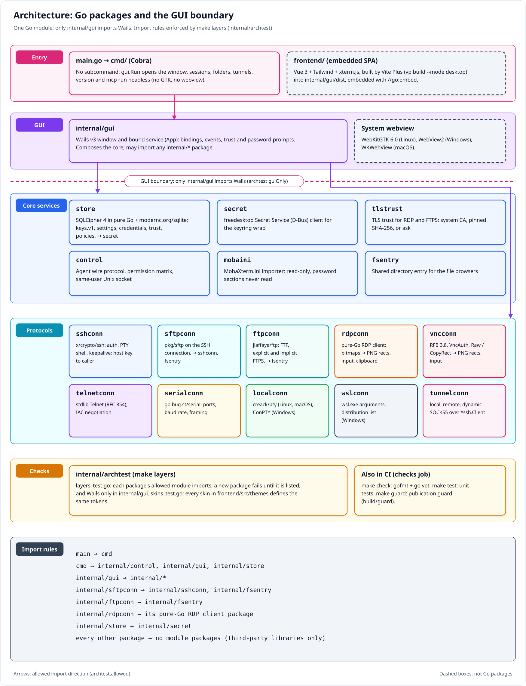
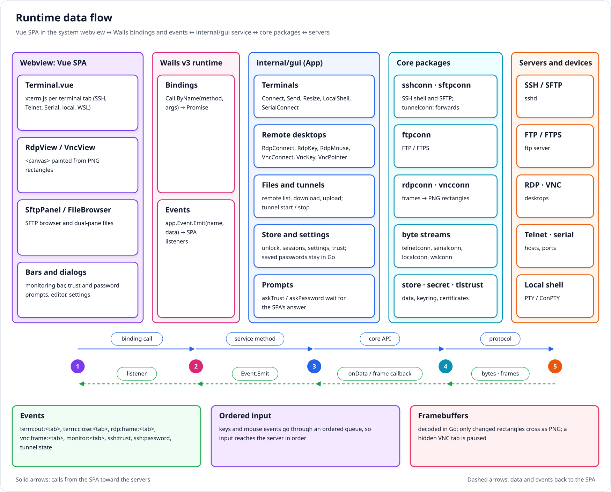
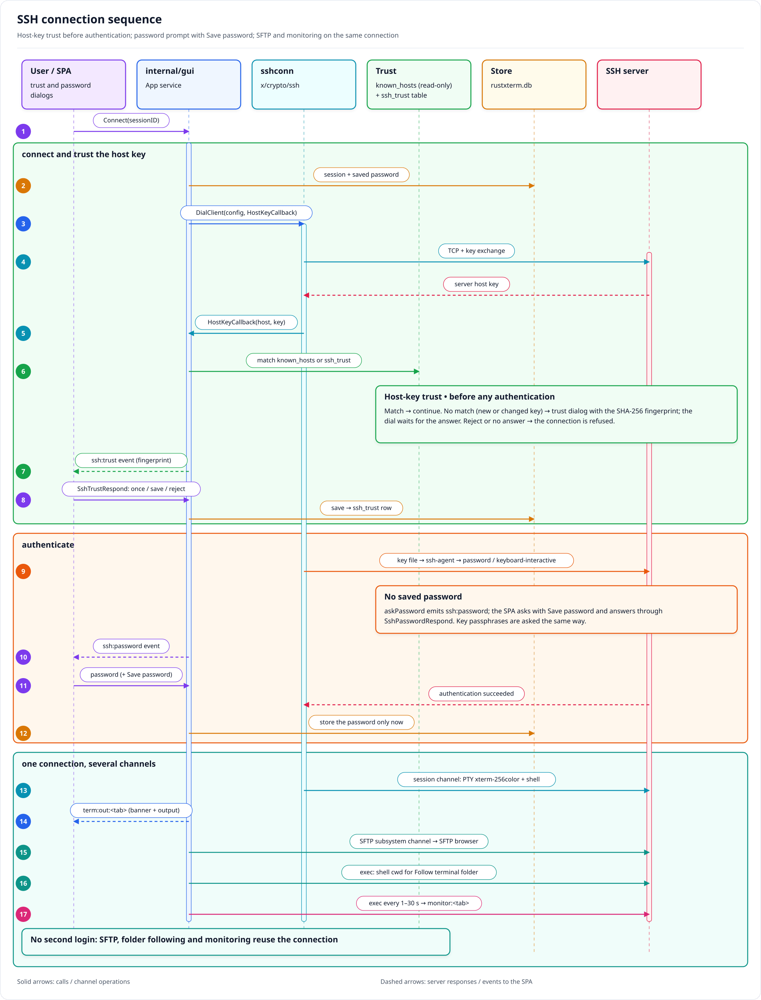
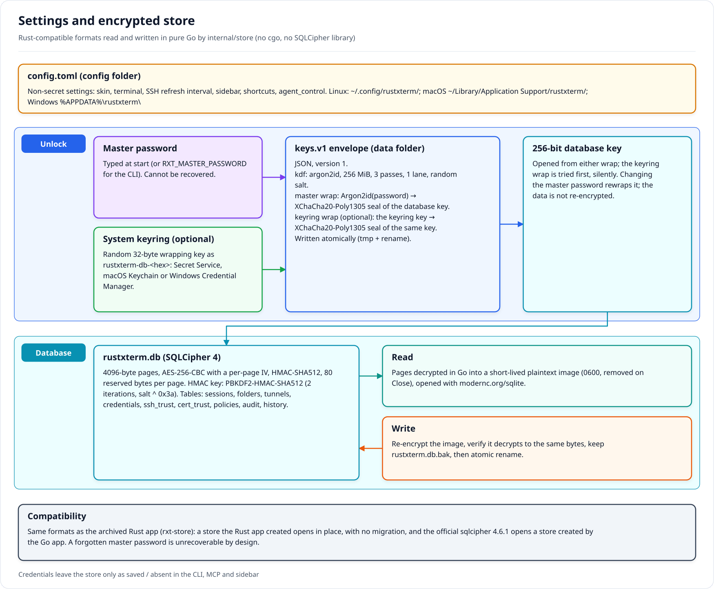
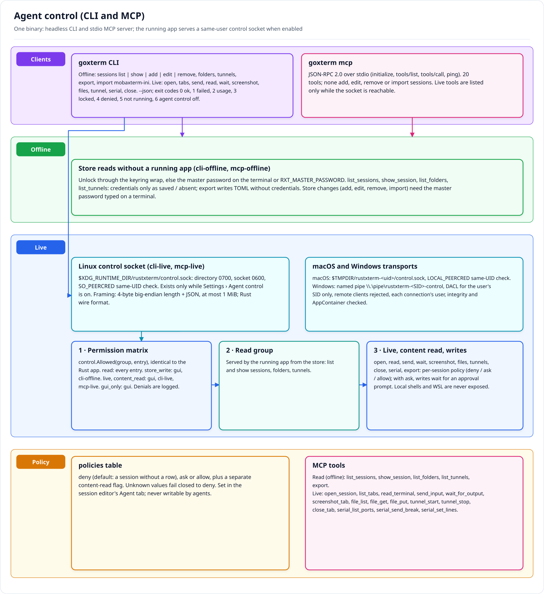
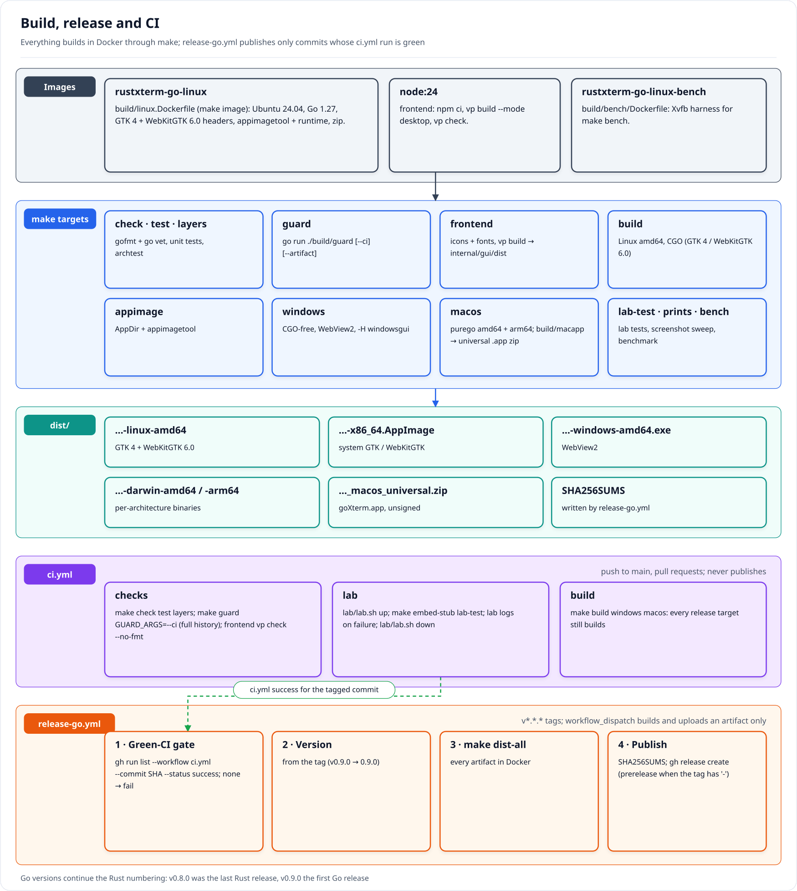
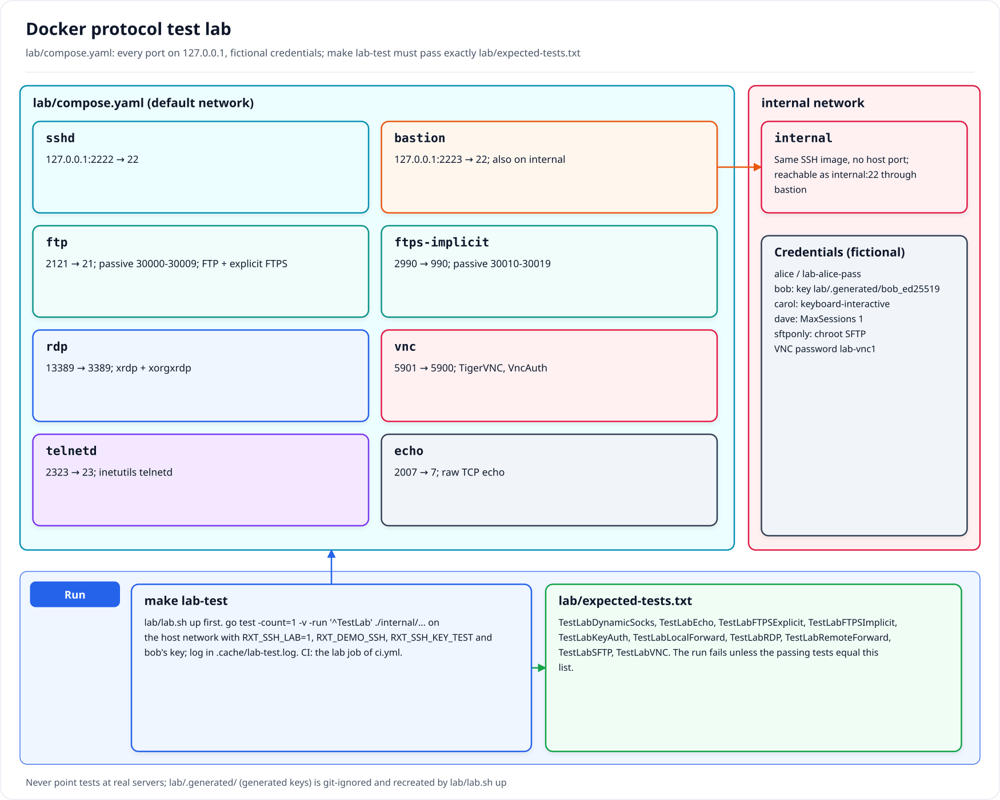
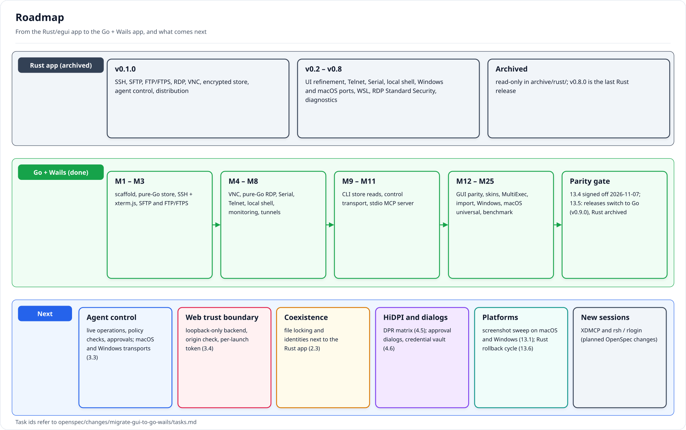

# rustXterm documentation

Index of the project documentation. Start with the [root README](../README.md) for features, install and
quick start, and the [developer guide](DEVELOPMENT.md) to build, test and contribute. Design decisions and
requirements live in OpenSpec under [`openspec/`](../openspec/); the Go app was built by the
[`migrate-gui-to-go-wails`](../openspec/changes/migrate-gui-to-go-wails/) change.

- [Developer guide](DEVELOPMENT.md)
- [Architecture](#architecture)
- [Runtime data flow](#runtime-data-flow)
- [SSH connections](#ssh-connections)
- [RDP connections (user guide)](rdp.md): security layers, legacy RDP security, trust prompts, errors
- [Settings and encrypted store](#settings-and-encrypted-store)
- [Agent control (CLI and MCP)](#agent-control-cli-and-mcp)
- [Local terminal](#local-terminal)
- [Terminal color schemes and zoom](#terminal-color-schemes-and-zoom)
- [Skins](#skins)
- [Build, release and CI](#build-release-and-ci)
- [Protocol test lab](#protocol-test-lab)
- [Gate receipts](#gate-receipts)
- [Roadmap and OpenSpec changes](#roadmap-and-openspec-changes)
- [Screenshots](#screenshots)
- [Diagrams](#diagrams)

## Architecture

rustXterm is one Go module (`goxterm`) built with Wails v3. `main.go` hands over to `cmd/` (Cobra):
with no subcommand it opens the desktop window (`internal/gui`), otherwise it runs the CLI or the MCP
server headless. The core is GUI-free packages under `internal/`; only `internal/gui` imports Wails.
`make layers` runs `internal/archtest`, which refuses any import outside this table and checks that every
skin defines the same CSS tokens.

| Group | Packages | May import (module packages) |
|---|---|---|
| Entry | `main`, `cmd` | `main` → `cmd`; `cmd` → `internal/control`, `internal/gui`, `internal/store` |
| GUI | `internal/gui` (Wails service and events, embedded SPA in `internal/gui/dist`) | any `internal/*` |
| Protocols | `sshconn`, `sftpconn`, `ftpconn`, `rdpconn`, `vncconn`, `telnetconn`, `serialconn`, `localconn`, `wslconn`, `tunnelconn` | none, except `sftpconn` → `sshconn`, `fsentry`; `ftpconn` → `fsentry`; `rdpconn` → its pure-Go RDP client |
| Core services | `store` (SQLCipher store, settings, credentials, trust, policies), `secret` (Secret Service), `tlstrust`, `control`, `mobaini`, `fsentry` | none, except `store` → `secret` |

The frontend (`frontend/`) is Vue 3 + Tailwind, built by Vite Plus (`vp build --mode desktop`) into
`internal/gui/dist` and embedded in the binary; the terminal is xterm.js, remote desktops are drawn on a
`<canvas>`.

## Runtime data flow

The SPA runs in the system webview and calls methods of the bound `internal/gui` service through Wails
bindings (`Connect`, `Send`, `Resize`, `RdpConnect`, `VncConnect`, `SerialConnect`, `LocalShell`, and the
tunnel, SFTP and store methods). The service composes the core packages, which talk to the servers.
Results flow back as Wails events: `term:out:<tab>` and `term:close:<tab>` for terminals (SSH, Telnet,
Serial, local, WSL), `rdp:frame:<tab>` and `vnc:frame:<tab>` with changed rectangles as PNG, and
`monitor:<tab>` samples for the monitoring bar. Questions that need the user (`ssh:trust`,
`ssh:password`, certificate trust) are events too; the Go side waits until the SPA answers through a
binding. Keyboard input goes through an ordered queue so keys reach the server in order.

## SSH connections

`sshconn` dials with `golang.org/x/crypto/ssh` and hands the host key to the GUI's callback before any
authentication. Trust comes from `~/.ssh/known_hosts` (read only) and the store's `ssh_trust` records (the
same table the Rust app wrote): a key that matches either continues, any other key (new or changed)
raises the trust dialog with its SHA-256 fingerprint (accept once, accept and save, reject). Authentication tries the session's key file (asking for its passphrase
when needed), then ssh-agent, then password and keyboard-interactive; a missing password is asked for,
and **Save password** stores it only after the login succeeds. The SFTP browser is an SFTP channel on the
same connection, Follow terminal folder resolves the shell's directory over it, and the monitoring bar
runs a one-shot command on an extra exec channel every refresh interval. Tunnels dial their own
connection with the same host-key and authentication path.

## Settings and encrypted store

Settings are `config.toml` in the config folder (`~/.config/rustxterm/` on Linux); sessions, folders,
tunnels, credentials, trust records and agent policies live in `rustxterm.db` in the data folder
(`~/.local/share/rustxterm/` on Linux; on macOS and Windows both are the platform config folder). The
formats are the Rust app's, so `internal/store` opens an existing store in place:

- `keys.v1` holds the 256-bit database key wrapped under the master password (Argon2id, 256 MiB, 3
  passes, 1 lane, then XChaCha20-Poly1305) and optionally under a random key kept in the system keyring
  (`rustxterm-db-<hex>` in the Secret Service, macOS Keychain or Windows Credential Manager).
- `rustxterm.db` is SQLCipher 4 (4096-byte pages, AES-256-CBC, HMAC-SHA512). `internal/store` decrypts it
  in pure Go into a short-lived owner-only plaintext image read with `modernc.org/sqlite` (no cgo); writes
  go back re-encrypted, verified and atomically replaced, keeping a `.bak` of the previous file.

A forgotten master password is unrecoverable by design.

## Agent control (CLI and MCP)

Scripts and AI agents use the `goxterm` CLI or the stdio MCP server (`goxterm mcp`), both
headless. Store reads (`sessions list|show`, `folders list`, `tunnels list` and the matching MCP tools)
work offline: they unlock the store through the keyring wrap or the master password. When **Settings ›
Agent control** is on, the running app listens on a same-user Unix socket
(`$XDG_RUNTIME_DIR/rustxterm/control.sock`, directory 0700, socket 0600, `SO_PEERCRED` check) with the
Rust app's framing (4-byte big-endian length + JSON, 1 MiB cap) and wire format. Every request first
passes the permission matrix (`control.Allowed`, byte-identical to the Rust one); denials are logged.
The app serves the read group today. Live operations (open, read, send, wait, screenshot, files,
tunnels, close, serial), store writes over the socket, the per-session Deny / Ask / Allow check for
them, and the macOS and Windows transports are the remaining part of
[`migrate-gui-to-go-wails`](../openspec/changes/migrate-gui-to-go-wails/tasks.md) task 3.3. The policy
itself is already stored per session (default `deny`) and edited in the session editor's Agent tab.

## Local terminal

The tab strip **+** (default shortcut Ctrl+Shift+T) opens a shell on this computer in a pseudo-terminal
(`internal/localconn`): `creack/pty` on Linux and macOS, a native ConPTY on Windows 10 1809 and later.
The shell is `$SHELL`, else the login shell from `/etc/passwd`, else `/bin/sh` (Windows: `%COMSPEC%`, else
`powershell.exe`); it starts in your home folder with `TERM=xterm-256color`. WSL sessions (Windows) run
`wsl.exe` in the same ConPTY.

## Terminal color schemes and zoom

**Settings › Terminal** sets the global color scheme; the session editor can override it per session.
Built in, with the Rust app's names and colors: rustxterm-light, rustxterm-dark, Solarized Dark,
Solarized Light, Dracula, Gruvbox Dark, Gruvbox Light, Nord, One Dark, Monokai, Tango Dark, Tango Light
and xterm. An empty scheme follows the UI skin (rustxterm-light or rustxterm-dark).

Font zoom: Ctrl+wheel, Ctrl+= / Ctrl++ and Ctrl+- change the font size, Ctrl+0 resets it.

## Skins

**Settings › Display › Skin** picks Light, Dark, Windows XP, macOS, macOS Dark, Mac OS Retro or System
(follows the OS light/dark setting live). Each skin is one CSS file in
[`frontend/src/themes/`](../frontend/src/themes/) keyed by `data-theme` and registered in `index.ts`;
`internal/archtest/skins_test.go` fails when a skin misses a token another skin defines.

## Build, release and CI

Builds, lints and tests run only in Docker through `make` (`rustxterm-go-linux` image from
`build/linux.Dockerfile`, `node:24` for the frontend). The Linux binary links GTK 4 and WebKitGTK 6.0
(CGO); Windows (WebView2) and macOS (Wails purego backend) cross-build CGO-free from the same image, and
`build/macapp` assembles the universal `goXterm.app` zip. `ci.yml` runs on `main` and pull requests
(jobs `checks`, `lab`, `build`) and never publishes; `release-go.yml` runs `make dist-all` on `v*.*.*` tags,
only for a commit whose `ci` run is green, and publishes the GitHub Release with `SHA256SUMS`.

- [Developer guide](DEVELOPMENT.md)
- [Cutting a release](release.md)

## Protocol test lab

A disposable Docker Compose lab ([`lab/compose.yaml`](../lab/compose.yaml): sshd, bastion + internal
host, vsftpd with explicit and implicit FTPS, xrdp, TigerVNC, telnetd, a TCP echo service) binds every
port to `127.0.0.1` and uses fictional credentials. `lab/lab.sh up` starts it; `make lab-test` runs the Go
`TestLab*` tests on the host network and fails unless the tests that pass equal
[`lab/expected-tests.txt`](../lab/expected-tests.txt).

- [Lab README](../lab/README.md)

## Gate receipts

Each milestone ends with a verification batch; its receipt records commands and results.

- [Go app parity gate](gates/go-parity.md): screens and skins, protocols with lab evidence, platforms and
  the benchmark against Rust v0.8.0 (signed off 2026-11-07)

Receipts of the archived Rust app:

- [M1: usable SSH](gates/m1.md)
- [M2: files and remote desktops](gates/m2.md)
- [M4: agent control](gates/m4.md)
- [Release v0.1.0: distribution matrix, CI, acceptance, scenario map](gates/release.md)
- [Windows port](gates/windows.md), [WSL sessions](gates/wsl.md),
  [RDP Standard Security](gates/rdp-standard-security.md)

## Roadmap and OpenSpec changes

| Change | Scope | Status |
|---|---|---|
| [`migrate-gui-to-go-wails`](../openspec/changes/migrate-gui-to-go-wails/) | Go + Wails v3 app replacing the Rust/egui app | Parity gate signed off; releases switched to Go (from v0.9.0) and the Rust app archived. Open: live agent operations and macOS/Windows control transports (3.3), web trust boundary (3.4), coexistence locking (2.3), HiDPI matrix (4.5), approval dialogs and credential vault (4.6), macOS/Windows screenshot sweep (13.1), rollback cycle (13.6) |
| [`add-xdmcp-sessions`](../openspec/changes/add-xdmcp-sessions/) | XDMCP through an external `Xvnc` shown in a VNC tab | Planned |
| [`add-rsh-sessions`](../openspec/changes/add-rsh-sessions/) | rlogin / rsh / rexec, legacy and off by default | Planned |

The other changes in `openspec/changes/` (`add-telnet-sessions`, `add-serial-sessions`, `add-local-shell`,
`add-windows-port`, `add-macos-port`, `add-rdp-standard-security`, `add-diagnostic-logging`,
`fix-windows-receipt-gaps`, `refine-ui-layout`) were implemented in the Rust app; the Go app's coverage of
them is recorded in the parity gate.

## Screenshots

Screens of the Go app in the Light and Dark skins, captured on Linux by `make prints`, are in the
[screenshot gallery](screenshots/README.md). The archived Rust app's renders are in
[`archive/rust/docs/screenshots/`](../archive/rust/docs/screenshots/README.md).

## Diagrams

All diagrams are in [`diagrams/`](diagrams/) as SVG (source) and PNG. They were drawn by the rustXterm
developers with AI coding assistants (Codex CLI, Claude Code) from the design documents and the code,
and are MIT licensed (see [ATTRIBUTION.md](../ATTRIBUTION.md)).

| File | Shows |
|---|---|
| `01-architecture-layers` | Go packages by group, the import rules `internal/archtest` enforces and the GUI boundary |
| `02-runtime-dataflow` | Vue SPA in the webview, Wails bindings and events, `internal/gui` service, core packages and servers |
| `03-ssh-connection-sequence` | Host-key trust before authentication, password prompt with Save password, SFTP and monitoring on the same connection |
| `04-encrypted-store` | `config.toml`, the `keys.v1` envelope with master and keyring wraps, SQLCipher 4 and the write-back path |
| `05-agent-control` | CLI/MCP, control socket, permission matrix, per-session policy and what is served today |
| `06-build-release` | Docker images, `make` targets, `dist-all` artifacts, `ci.yml` jobs and the `release-go.yml` green-CI gate |
| `07-test-lab` | Docker lab services, ports and networks, `make lab-test` and the expected-tests list |
| `08-roadmap` | Rust milestones, the Go migration and the next items |
| `09-rdp-connection-sequence` | RDP trust-before-credentials flow: modern TLS/NLA vs legacy TLS or Standard RDP Security, capability exchange, the active stage and a clean logout |
