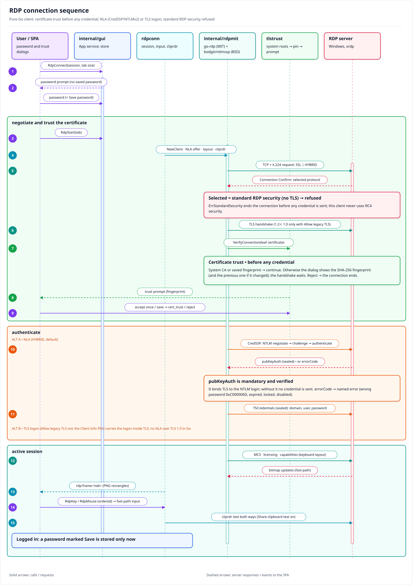

# Connecting to Windows with RDP

rustXterm has its own RDP client, written in pure Go (Linux, Windows and macOS); no `mstsc`, FreeRDP or
other external program is used. This guide covers the session options, the security layers Windows
servers use, the trust prompts and the errors you can meet, with the fix for each.



## Quick start

1. **New session → RDP**, enter the host, port (default 3389) and user name. The user name accepts the
   same forms as `mstsc`:
   - `administrator` (with the domain, if any, in the RDP options' **Domain** field);
   - `TRD-APP01\administrator` or `CORP\alice`: the part before `\` is the domain (a local account of
     server `TRD-APP01`, or domain `CORP`);
   - `.\administrator`: a local account of the server you connect to;
   - `alice@corp.example` (UPN).
2. Connect and enter the password (tick **Save password** to keep it; it is stored only after the login
   succeeds). It is held in memory until the server is trusted and travels only inside TLS.
3. The first time, rustXterm shows the server certificate's SHA-256 fingerprint: compare it with the
   one your administrator gives you, then **Accept** (this time) or **Accept and save**. No credential is
   sent to the server before you accept.

## Session options

| Option | Default | What it does |
|---|---|---|
| Domain | empty | Domain of the account (`LAB`, `corp.example`), used when the user name has none. |
| Resolution | Fit to tab | The remote desktop takes the tab's size when you connect (the image is scaled when the tab changes size later); or a fixed size. |
| Keyboard layout | Server default | Layout sent to the server (e.g. US 0x0409, Brazilian ABNT2 0x0416). |
| Share clipboard text | On | Copy and paste text between the local desktop and the remote one. Off: the clipboard channel is not opened at all. |
| Allow legacy TLS 1.0/1.1 | Off | For old servers (Windows Server 2008/2008 R2 without updates) that only speak TLS 1.0. Less secure; see [Old servers](#old-servers-windows-server-2008--2008-r2). |
| Allow legacy RDP security | — | Shown disabled: this client never uses standard RDP security (see below). |

To leave a remote desktop that has the keyboard, press the release keys (default **Ctrl+Alt**, Settings → General →
**Keyboard release keys**).

## Security layers

The Windows setting **Remote Desktop Session Host → Security → "Require use of specific security layer
for remote (RDP) connections"** (registry `SecurityLayer` under
`HKLM\SYSTEM\CurrentControlSet\Control\Terminal Server\WinStations\RDP-Tcp`) decides how the connection
is protected:

| Server Security Layer | What rustXterm uses |
|---|---|
| Negotiate (`1`, Windows default) | TLS + NLA (CredSSP/NTLMv2), or TLS only when NLA is off on the server |
| SSL (`2`) | TLS (+ NLA when "Require user authentication… (NLA)" is on) |
| RDP (`0`) | **Not supported**: refused before any credential is sent |

### Standard RDP security (Security Layer = RDP) is refused

Standard RDP security has no TLS: the server cannot be authenticated and the logon travels under RC4.
rustXterm does not implement it. When a server picks it, the connection stops with
`the server only offers standard RDP security (no TLS), which is not supported`, and nothing has been
sent. Change the server to Negotiate or SSL:

Group Policy (domain or `gpedit.msc`): *Computer Configuration → Administrative Templates → Windows
Components → Remote Desktop Services → Remote Desktop Session Host → Security →* **Require use of
specific security layer for remote (RDP) connections** = **Negotiate** (or **SSL**). Keep **Require user
authentication for remote connections by using Network Level Authentication** enabled.

Without Group Policy, in an elevated PowerShell on the server:

```powershell
$k = 'HKLM:\SYSTEM\CurrentControlSet\Control\Terminal Server\WinStations\RDP-Tcp'
Set-ItemProperty $k SecurityLayer 1        # 1 = Negotiate, 2 = SSL
Set-ItemProperty $k UserAuthentication 1   # NLA
```

New connections use the new setting at once; a Group Policy value overrides the registry value.

### NLA

NLA (CredSSP) authenticates you before the server starts a session. rustXterm does it with NTLMv2
over TLS 1.2/1.3 and checks the server's CredSSP reply (`pubKeyAuth`), which binds the TLS channel to
your login; without that reply the credentials are never sent. Kerberos is not used, so an account must
be able to log on with NTLM.

## Old servers (Windows Server 2008 / 2008 R2)

These servers typically speak only **TLS 1.0**. Tick **Allow legacy TLS 1.0/1.1**: without it the
client offers only TLS 1.2/1.3 and the connection stops with
`the server only offers legacy TLS (TLS 1.0/1.1)`.

With the option on, rustXterm connects with **TLS + the standard RDP logon** (no NLA). Go's TLS
library always splits TLS 1.0 records (a BEAST countermeasure that cannot be turned off) and the 2008
SChannel aborts CredSSP on that, so NLA over TLS 1.0 is not possible in this client. The password still
travels only inside TLS. A 2008 server that *requires* NLA therefore needs TLS 1.2 enabled on the
server.

Right after the logon these servers deactivate the session and activate it again
(deactivation-reactivation); rustXterm redoes the capability exchange and the desktop continues.
Tested against Windows Server 2008 R2 (`dockur/windows`) at 1688×968.

Prefer enabling TLS 1.2 on the server when you can; the legacy option is a client-side workaround, not
a fix for the server.

## Certificates and trust

- TLS servers present a certificate; Windows uses a self-signed one by default. A certificate the
  system trusts (a CA your machine knows) is accepted silently. Any other one is shown with its SHA-256
  fingerprint; **Accept and save** stores it per host name and port.
- If a saved certificate changes, the prompt comes back showing the new and the previous fingerprints,
  before any credential is sent. This happens after a server reinstall or certificate renewal, and
  also when someone intercepts the connection: confirm with the administrator before accepting.
- **Reject** ends the connection.

## Errors and fixes

| Message (contains) | Cause | Fix |
|---|---|---|
| `the server only offers standard RDP security (no TLS)` | Server Security Layer = RDP | Change the server to Negotiate or SSL (above) |
| `NLA: wrong user name or password (0xC000006D)` | Wrong user, domain or password; or a local account sent without a domain to a domain-joined server | Check the credentials and the Domain field; for a local account use `.\user` |
| `NLA: the password has expired and must be changed` | Password expired | Change it (e.g. with `mstsc` or on the console) and connect again |
| `NLA: the account is locked` / `is disabled` | Account state | Ask the administrator |
| `server requires Network Level Authentication (NLA)` | **Allow legacy TLS** is on but the server requires NLA | Turn the option off (and enable TLS 1.2 on the server if it is a 2008 one) |
| `certificate not trusted for HOST:PORT` | You rejected the certificate prompt | Connect again and compare the fingerprint |
| `the server only offers legacy TLS (TLS 1.0/1.1)` | Old server (2008/2008 R2) that only speaks TLS 1.0 | Tick **Allow legacy TLS 1.0/1.1** |
| `the server closed the connection before the session started` | The server dropped the connection after the logon (licensing, policy or a session limit) | Check the server's event log (TerminalServices-*) and the RD licensing mode |
| `dial tcp …: i/o timeout` / `connection refused` | Port 3389 blocked, RDP disabled or wrong host | Check the firewall and "Allow remote connections to this computer" |

## Testing it yourself

The Docker lab (`lab/`) runs an xrdp server; `make lab-test` connects to it (TLS, rejected
certificate, NLA offer). The clipboard test (`TestLabRDPClipboard`) needs `RXT_RDP_CLIP=1` and the
`xclip` steps in its comment.

To check a real Windows host, `TestRealRDP` connects and captures one frame without sending input:

```bash
RXT_RDP_REAL=1 RXT_RDP_HOST=<host> RXT_RDP_USER=<user> RXT_RDP_PASS=<password> RXT_RDP_PROTO=nla \
  go test ./internal/rdpconn -run TestRealRDP -v
```

(`RXT_RDP_PROTO` is `nla` or `ssl`; `RXT_RDP_LEGACY=1` allows TLS 1.0; `RXT_RDP_LAYOUT=0x0416` sets the
keyboard layout.) Run it in the Docker build image, against your own or authorised hosts only. The
repository's Windows test VMs are described in [`lab/vagrant/README.md`](../lab/vagrant/README.md);
`dockur/windows` works too.
