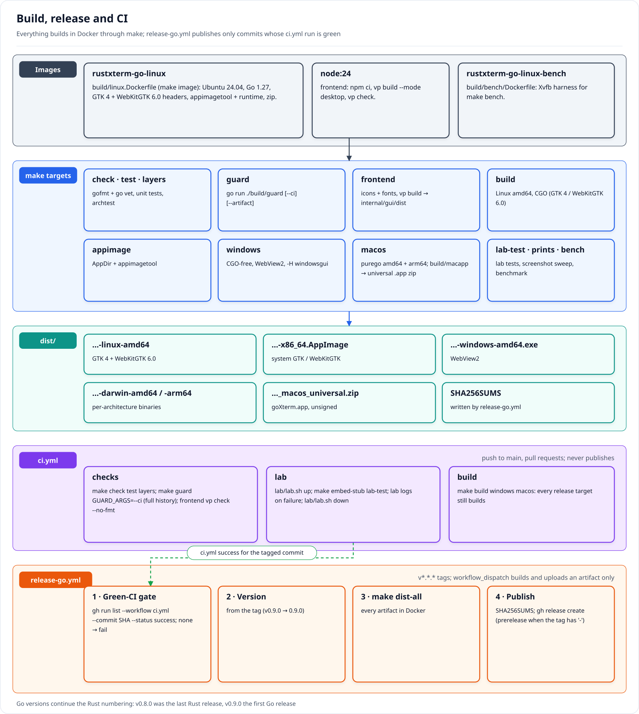

# Cutting a release

Binaries are built only by `.github/workflows/release-go.yml`, which runs when a tag `vX.Y.Z` (or
`vX.Y.Z-rc.N`) is pushed. `ci.yml` runs the checks, the lab and the cross-builds on `main` and pull
requests and never uploads binaries. The Go app continues the Rust version numbering: the last Rust
release is v0.8.0 and the first Go release is v0.9.0. The Rust release workflow is archived, disabled,
as `archive/rust/release.yml`. The step-by-step procedure, including release notes, is the
[`create-release` skill](../.claude/skills/create-release/SKILL.md).

1. Merge to `main`. The tag is the version: `make` reads it with `git describe --exact-match --match 'v*'`,
   so no file needs a version bump.
2. Wait for `ci` to pass on that commit:

   ```sh
   gh run list --workflow ci.yml --commit "$(git rev-parse HEAD)" --json status,conclusion -q '.[0]'
   ```

3. Tag and push:

   ```sh
   git tag -a vX.Y.Z -m "Release vX.Y.Z" && git push origin vX.Y.Z
   ```

`release-go.yml` does not rerun the checks. It refuses to publish unless the tagged commit has a
successful `ci.yml` run, then runs `make dist-all VERSION=X.Y.Z` in Docker, writes `SHA256SUMS` and
creates the GitHub Release (generated notes plus the macOS quarantine hint) with:

- `rustxterm-go-X.Y.Z-linux-amd64` (GTK 4 + WebKitGTK 6.0)
- `rustxterm-go-X.Y.Z-x86_64.AppImage`
- `rustxterm-go-X.Y.Z-windows-amd64.exe` (WebView2)
- `rustxterm-go-X.Y.Z_macos_universal.zip` (unsigned `rustXterm (Go).app`, Apple Silicon and Intel)
- `rustxterm-go-X.Y.Z-darwin-amd64` and `rustxterm-go-X.Y.Z-darwin-arm64`
- `SHA256SUMS`

Tags with a `-` suffix are published as pre-releases. Releases are unsigned (no Apple Developer ID or
Windows code signing).

## Local dry run

```sh
make dist-all VERSION=0.0.0-test
(cd dist && sha256sum -- * > SHA256SUMS)
make guard GUARD_ARGS="--artifact dist/rustxterm-go-0.0.0-test-x86_64.AppImage"
```

A manual run of `release-go.yml` (`workflow_dispatch`) builds everything with `VERSION=dev` and uploads
the files as a workflow artifact without publishing a release.


